# Developer Documentation - drmdevice

This document contains technical documentation for developers.

## Playmode Graph

This graph is a representation, how VDR changes the playmode and which commands are called in the device. It is the base graph for the following state diagrams. Simply walk through the graph from top to bottom. Every box start with the VDR command (Play(), Pause(), Forward(), Backward()) and includes the current playmodes the command is executed on.

```mermaid
graph TD
%% Playmodes

    Player --> ToPlayPlay["**Play():**<br>pmPause<br>pmPlay<br>pmSlow(forward)"]
    Player --> ToPlayPause["**Pause():**<br>pmStill<br>pmPause"]
    ToPlayPlay --------> DevicePlay["DevicePlay()"]
    ToPlayPause --------> DevicePlay["DevicePlay()"]

    Player--> ToFreezeForward["**Forward():**<br>pmSlow(forward)"]
    ToFreezeForward --------> DeviceFreeze["DeviceFreeze()"]

    Player--> ToMuteForward["**Forward():**<br>pmStill<br>pmPause"]
    ToMuteForward ------> DeviceMute["DeviceMute()"]

    Player --> ToClearPlay["**Play():**<br>pmStill<br>pmFast(forward)<br>pmFast(backward)<br>pmSlow(backward)"]
    Player --> ToClearPause["**Pause():**<br>pmFast(forward)<br>pmFast(backward)<br>pmSlow(backward)"]
    Player--> ToClearForward["**Forward():**<br>pmPlay<br>pmFast(forward)<br>pmFast(backward)<br>pmSlow(backward)"]
    Player --> ToClearBackward["**Backward():**<br>pmStill<br>pmPause<br>pmPlay<br>pmFast(forward)<br>pmFast(backward)<br>pmSlow(forward)<br>pmSlow(backward)"]

    Player --> ToClearStillPicture["**Goto():**<br>Mark editing<br>(pause after edit)"]
    ToClearStillPicture ---> DeviceClear["DeviceClear()"]
    DeviceClear ---> ClearToStillPicture["**Goto():**<br>Mark editing<br>(pause after edit)"]
    ClearToStillPicture ----> DeviceStillPicture["DeviceStillPicture()"]

    Player --> ToClearStillPicture2["**Goto():**<br>Mark editing<br>(play after edit)"]
    ToClearStillPicture2 ---> DeviceClear["DeviceClear()"]
    DeviceClear ---> ClearToPlayStillPicture["**Goto():**<br>Mark editing<br>(play after edit)"]
    ClearToPlayStillPicture ----> DevicePlay["DevicePlay()"]

    Player --> ToClearSkip["**SkipSeconds():**<br>Yellow/Green jumping"]
    ToClearSkip ---> DeviceClear["DeviceClear()"]
    DeviceClear ---> ClearToPlaySkip["**SkipSeconds():**<br>Yellow/Green jumping"]
    ClearToPlaySkip ----> DevicePlay["DevicePlay()"]

    ToClearPlay ---> DeviceClear["DeviceClear()"]
    ToClearPause ---> DeviceClear["DeviceClear()"]
    ToClearForward ---> DeviceClear["DeviceClear()"]
    ToClearBackward ---> DeviceClear["DeviceClear()"]

    Player --> ToFreeze["**Pause():**<br>pmPlay<br>pmSlow(forward)"]
    ToFreeze --------> DeviceFreeze["DeviceFreeze()"]

    DeviceClear ---> ClearToPlayPlay["**Play():**<br>pmStill<br>pmFast(forward)<br>pmFast(backward)<br>pmSlow(backward)"]
    DeviceClear ---> ClearToPlayBackward["**Backward():**<br>pmFast(backward)"]
    DeviceClear ---> ClearToPlayForward["**Forward():**<br>pmFast(forward)"]
    ClearToPlayPlay ----> DevicePlay["DevicePlay()"]
    ClearToPlayForward ----> DevicePlay["DevicePlay()"]
    ClearToPlayBackward ----> DevicePlay["DevicePlay()"]

    DeviceClear ---> ClearToMuteForward["**Forward():**<br>pmPlay<br>pmFast(backward)<br>pmSlow(backward)"]
    DeviceClear ---> ClearToMuteBackward["**Backward():**<br>pmStill<br>pmPause<br>pmPlay<br>pmFast(forward)<br>pmSlow(forward)"]
    ClearToMuteForward --> DeviceMute["DeviceMute()"]
    ClearToMuteBackward --> DeviceMute["DeviceMute()"]

    DeviceMute --> ToTrickSpeedForward["**Forward():**<br>pmStill<br>pmPause<br>pmPlay<br>pmFast(backward)<br>pmSlow(backward)"]
    DeviceMute --> ToTrickSpeedBackward["**Backward():**<br>pmStill<br>pmPause<br>pmPlay<br>pmFast(forward)<br>pmSlow(forward)"]
    ToTrickSpeedForward --> DeviceTrickSpeed["DeviceTrickSpeed"]
    ToTrickSpeedBackward --> DeviceTrickSpeed["DeviceTrickSpeed"]

    DeviceClear ---> ClearToFreezePause["**Pause():**<br>pmFast(forward)<br>pmFast(backward)<br>pmSlow(backward)"]
    DeviceClear ---> ClearToFreezeBackward["**Backward():**<br>pmSlow(backward)"]
    ClearToFreezePause ----> DeviceFreeze["DeviceFreeze()"]
    ClearToFreezeBackward ----> DeviceFreeze["DeviceFreeze()"]

    DevicePlay --> pmPlay["pmPlay"]
    DeviceFreeze --> pmPause["pmPause"]
    DeviceStillPicture --> pmStill["pmStill"]
    DeviceTrickSpeed --> pmTrick["pmFast(forward)<br>pmFast(backward)<br>pmSlow(forward)<br>pmSlow(backward)"]

    %% Styling
    classDef player fill:#90caf9,stroke:#1976d2,stroke-width:2px,color:#000000
    classDef endpoint fill:#e57373,stroke:#d32f2f,stroke-width:3px,color:#000000
    classDef commands fill:#81c784,stroke:#388e3c,stroke-width:2px,color:#000000

    class Player player
    class DeviceClear,DeviceMute commands
    class DevicePlay,DeviceFreeze,DeviceTrickSpeed,DeviceStillPicture endpoint
```

## State Diagram

This is the model of the state machine implemented in statemachine.cpp.  
The diagram doesn't contain the DetachEvent. This event can be triggered in every state and causes a state change to DETACHED.

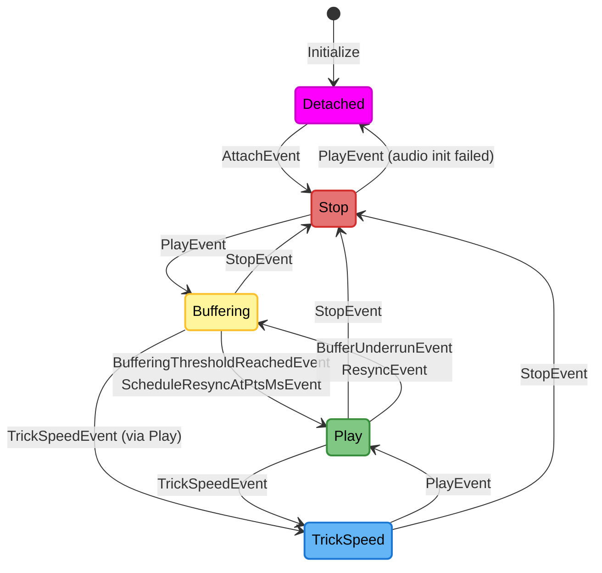

Some events are handled without a state change:

- `PauseEvent` pauses the playback in PLAY and TRICK_SPEED (ignored in BUFFERING).
- `PlayEvent` resumes a paused playback in PLAY.
- `TrickSpeedEvent` changes the speed or direction in TRICK_SPEED.
- `StillPictureEvent` shows a still picture in STOP, BUFFERING, PLAY and TRICK_SPEED.
- `DisplayChangeEvent` changes the display mode in every state except DETACHED.
- `ScheduleResyncAtPtsMsEvent` schedules a resync in PLAY.
- A `BufferUnderrunEvent` is ignored in STOP, BUFFERING and TRICK_SPEED.

## Video Data Flow Call Graph

This section shows the complete data flow of video frames from VDR through the plugin to the display hardware.

### Overview

The video pipeline consists of 4 main threads:

1. 🔵**VDR Thread** - Receives video data from VDR (`cOutputDevice::PlayVideo()`)
2. 🟣**Decoding Thread** - Decodes video packets using FFmpeg (`cVideoStream::Action()`)
3. 🟠**Filter Thread** - Applies filters (deinterlacing, conversion to NV12) (`cVideoFilter::Action()`)
4. 🟢**Display Thread** - Syncs with audio and commits frames to DRM/KMS (`cVideoRender::Action()`)

- 🔴 Hardware (DRM/KMS display hardware)
- 🟡 Buffers (frame buffers and queues)

Besides the video pipeline, the audio thread (`cAudioStream::Action()`) writes the audio to ALSA, the event handler thread (`cEventHandler::Action()`) runs the state machine and the OpenGL thread (`cOglThread::Action()`) renders the OSD.

### Detailed Call Graph

```mermaid
graph TD
    %% VDR Thread
    VDR[VDR Core] --> |PES Packet|PlayVideo["cOutputDevice::PlayVideo"]
    PlayVideo --> |PES Packet|PlayVideoInternal["cOutputDevice::PlayVideoInternal"]
    PlayVideoInternal --> |PES Payload|Reassembly["cReassemblyBufferVideo<br/>Push/PopAvPacket"]
    Reassembly --> |AVPacket|PushPkt["cVideoStream::PushAvPacket"]
    PushPkt --> |AVPacket|PktQueue["cVideoStream::m_packets<br/>**192**x AVPacket"]

    %% Decoding Thread
    PktQueue --> DecThread["cVideoStream::Action"]
    DecThread --> DecInput["cVideoStream::DecodeInput"]
    DecInput --> |AVPacket|SendPkt["cVideoDecoder::SendPacket"]
    SendPkt --> |MPEG2/H.264/HEVC Decoding|RecvFrame["cVideoDecoder::ReceiveFrame"]
    RecvFrame --> |AVFrame|DecInput
    DecInput --> |AVFrame|RenderFrame["cVideoStream::RenderFrame"]

    %% Filter Thread Decision
    RenderFrame --> |AVFrame|FormatCheck{Frame format?}
    FormatCheck -->|YUV420P or<br/>DRM_PRIME to be deinterlaced| FilterPush["cVideoFilter::PushFrame"]
    FormatCheck -->|DRM_PRIME| PushMainFrame["cVideoRender::PushMainFrame"]

    %% Filter Thread Path
    FilterPush --> FilterQueue["cVideoFilter::m_frames<br/>**3**x AVFrame"]
    FilterQueue --> FilterAction["cVideoFilter::Action"]
    FilterAction --> |Interlaced DRM_PRIME|HWDeint["FFmpeg filter:<br/>HW Deinterlacer"]
    FilterAction --> |YUV420P|SWDeint["FFmpeg filter:<br/>Convert to NV12 with optional SW Deinterlacing"]
    HWDeint -->|Progressive DRM_PRIME| PushMainFrame
    SWDeint --> |NV12|PushMainFrame

    %% Render buffers
    PushMainFrame --> |AVFrame|PushFrame["cVideoRender::PushFrame<br/>cVideoRender::m_drmBufferPool **36**x cDrmBuffer"]
    PushFrame --> |cDrmBuffer|RenderQueue["cVideoRender::m_drmBufferQueue<br/>**5**x cDrmBuffer"]

    %% Display Thread
    RenderQueue --> |cDrmBuffer|DispThread["cVideoRender::Action"]
    DispThread --> DisplayFrame["cVideoRender::DisplayFrame<br/>(A/V sync)"]
    DisplayFrame --> |cDrmBuffer|PageFlip["cVideoRender::PageFlip"]
    PageFlip --> |cDrmBuffer|CommitBuf["cVideoRender::CommitBuffer"]

    CommitBuf --> |cDrmDevice|DrmCommit["drmModeAtomicCommit"]

    DrmCommit --> Hardware["Display Hardware"]

    %% Styling
    classDef vdrThread fill:#90caf9,stroke:#1976d2,stroke-width:2px,color:#000000
    classDef decThread fill:#ce93d8,stroke:#8e24aa,stroke-width:2px,color:#000000
    classDef filterThread fill:#ffb74d,stroke:#f57c00,stroke-width:2px,color:#000000
    classDef displayThread fill:#81c784,stroke:#388e3c,stroke-width:2px,color:#000000
    classDef hardware fill:#e57373,stroke:#d32f2f,stroke-width:3px,color:#000000
    classDef buffer fill:#fff59d,stroke:#fbc02d,stroke-width:2px,color:#000000

    class VDR,PlayVideo,PlayVideoInternal,Reassembly,PushPkt vdrThread
    class DecThread,DecInput,SendPkt,RecvFrame,RenderFrame,FormatCheck,FilterPush decThread
    class FilterAction,HWDeint,SWDeint filterThread
    class DispThread,DisplayFrame,PageFlip,CommitBuf,DrmCommit displayThread
    class Hardware hardware
    class PktQueue,FilterQueue,PushMainFrame,PushFrame,RenderQueue buffer
```

The frames are pushed either by the decoding thread or by the filter thread into the render queue.
`cVideoRender::PushFrame()` takes a `cDrmBuffer` from the pool and wraps the frame into it (see "DRM Buffer Strategies").
If the HW deinterlacer is used, the filter thread waits, until two frames fit into the render queue (one for each field of the frame).

## Frame Routing

The following graph shows the path of the frames from the decoder to the display output device, also considering trick speed mode.

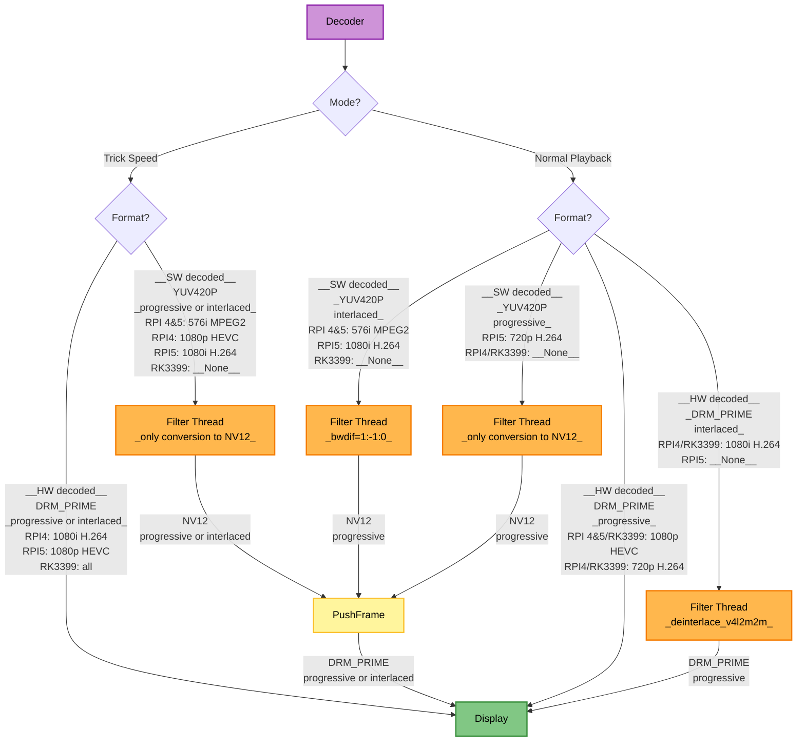

## Video Decoder

### Decoder Selection

The decoder is opened with the first decodable packet of a stream (`cVideoStream::OpenDecoder()`).
`cVideoDecoder::Open()` searches the FFmpeg decoders for the codec:

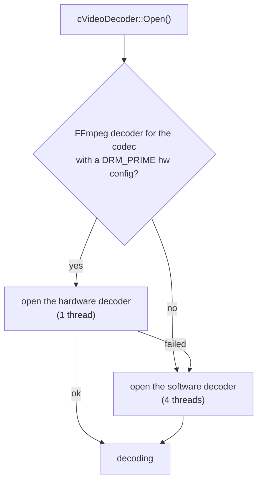

A hardware decoder outputs DRM_PRIME frames, a software decoder YUV420P frames (see "Frame Routing").
The decoder name and type are shown in the setup menu statistics.

### Error Handling

| Situation | Handling |
|-----------|----------|
| The decoder doesn't accept the packet (`EAGAIN`) | The packet stays in the queue and is sent again. |
| The decoder was drained (`EOF`) | The decoder is flushed. With `QUIRK_CODEC_FLUSH_WORKAROUND`, it is closed and opened again instead. |
| The hardware decoder fails (`EIO` on send or receive) | The decoder is restarted (`cVideoStream::RestartDecoder()`): it is closed and opened again with the next packet like a new stream. |
| The hardware decoder doesn't output a frame after `DecoderFallbackToSwNumPkts` packets | If `DecoderFallbackToSw` is set, the software decoder is used. |
| The PTS jumps more than 5s | The decoder is drained, so the frames before the jump are output first. |
| H.264 stream start with P-frames referencing missing frames | If `DropInvalidH264PFrames` is set, these P-frames are dropped up to the configured number of I-frames. |
| The decoder marks a frame as corrupt | The frame is displayed, a warning is logged. |

The setup menu shows the minimum for `DecoderFallbackToSwNumPkts` next to it: the maximum number of packets, which the hardware decoder needed for its first frame, plus one.

### Hardware Quirks

Some hardware needs special handling.
`cHardwareDevice` detects the hardware from the device tree (`/sys/firmware/devicetree/base/compatible`) and sets its quirks:

| Quirk | Hardware | Handling |
|-------|----------|----------|
| `QUIRK_CODEC_FLUSH_WORKAROUND` | Raspberry Pi 2-5 (bcm2836, bcm2837, bcm2711, bcm2712) | The hardware decoder doesn't flush correctly (`avcodec_flush_buffers()`), so it is closed and opened again. |

To add a quirk, extend `enum HardwareQuirks` and the device table in hardwaredevice.h and add a test in tests/test_hardwaredevice.cpp.

## DRM Buffer Strategies

A frame can only be displayed, if it is in a DRM framebuffer.
`cVideoRender::PushFrame()` takes a `cDrmBuffer` from the pool (`m_drmBufferPool`, 36 buffers) for every frame, which is pushed into the render queue.
Two strategies decide how this is done. Both are chosen with the first frame after they were reset:

- The **decoding strategy** (`cDecodingStrategy`) depends on the frame format and decides, how the frame gets into the buffer.
- The **buffer strategy** (`cBufferStrategy`) depends on the frame format and the trick speed and decides, which buffer of the pool is used.

| Frame                       | Decoding strategy           | Buffer strategy                 | Buffer used                                                         |
|-----------------------------|-----------------------------|---------------------------------|---------------------------------------------------------------------|
| DRM_PRIME (HW decoded)      | `cDecodingStrategyHardware` | `cBufferStrategyReuseHardware`  | the buffer, which already imported the DMA-BUF of the frame, otherwise an unused one |
| NV12 (SW decoded, filtered) | `cDecodingStrategySoftware` | `cBufferStrategyReuseSoftware`  | a buffer, whose presentation has finished, otherwise an unused one  |
| any frame in trick speed    | (as above)                  | `cBufferStrategyUseOnce`        | an unused buffer, which is destroyed after its presentation         |

### Hardware Decoded Frames

A hardware decoder outputs its frames in a small set of DMA-BUFs, which it uses again and again.
The DMA-BUF is imported into a buffer only once (`drmPrimeFDToHandle()`, `drmModeAddFB2WithModifiers()`).
The next frame in the same DMA-BUF uses the same buffer and its framebuffer again, the frame data isn't copied.

When the decoder is reopened, its new DMA-BUFs may get the file descriptor numbers of the old ones.
Therefore, a buffer is only reused, if the inode of the DMA-BUF is the same.
Otherwise, the buffers of the closed DMA-BUFs are destroyed (`cDrmBufferPool::DestroyStaleImports()`).
A buffer, which is queued or displayed, keeps its DMA-BUF open and is never destroyed.

### Software Decoded Frames

The frames of the filter thread are in normal memory.
Each buffer gets its own NV12 dumb buffer, and the frame is copied into it line by line (`cDecodingStrategySoftware::PrepareDrmBuffer()`).
After that, the frame is replaced by a DRM_PRIME frame, which references the buffer.
A buffer is created again, if the resolution changes.

### Trick Speed

In trick speed, the decoder is drained and flushed (or reopened) often, so its DMA-BUFs change.
Every buffer is used only once and destroyed after its presentation (`cBufferStrategyUseOnce`).

### Lifetime of a Buffer

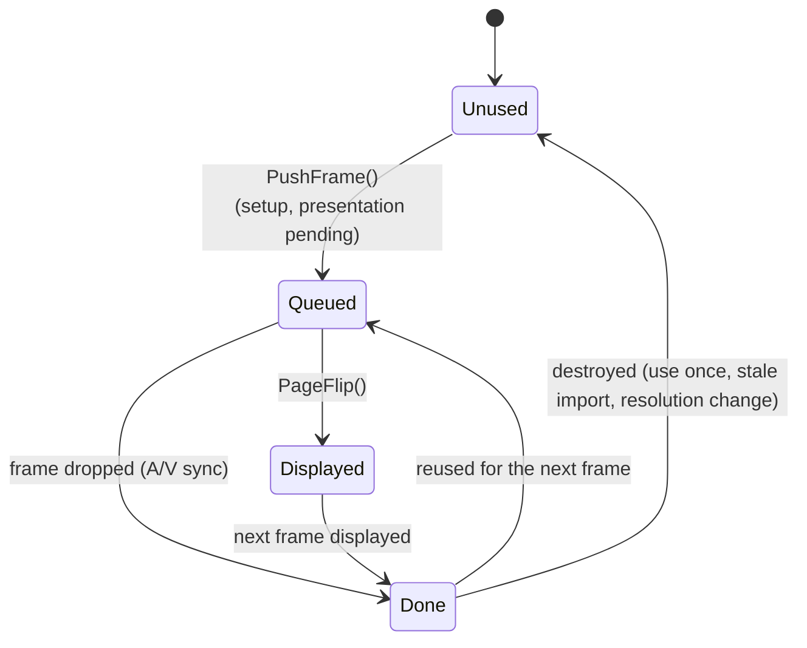

`cDrmBuffer::PresentationFinished()` frees the frame, so a hardware decoder gets its DMA-BUF back.

The buffer strategy is reset, when TRICK_SPEED is entered or left, both strategies are reset in STOP.

## Audio Data Flow Call Graph

The audio is received and decoded in the VDR thread.
The audio thread writes the samples (or the bitstream for passthrough) from a ringbuffer to ALSA.

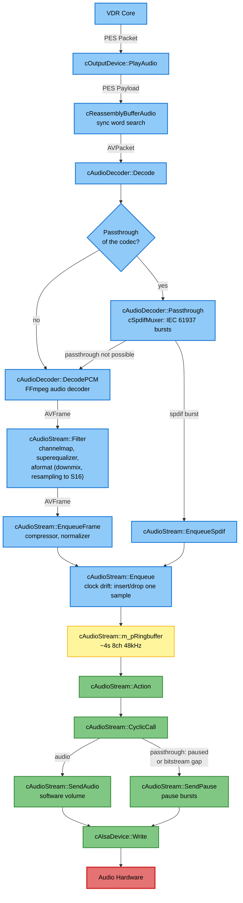

- 🔵 VDR thread
- 🟢 Audio thread
- 🔴 Hardware
- 🟡 Buffer

### Decoding and Passthrough

`cAudioDecoder::Decode()` passes the packet through, if the codec is enabled for passthrough (AC-3, E-AC-3, DTS, DTS-HD, TrueHD).
Otherwise, the packet is decoded to PCM.
The decoder is opened with the first packet and opened again, if the codec changes (e.g. AC-3 to E-AC-3 within the same PES stream id).

If the audio device can't be set up for the passthrough format (e.g. the needed sample rate isn't offered), the stream is decoded until the next codec change.
DTS-HD falls back to the passthrough of the DTS core first.

The audio device is set up again, when the format changes (`cAudioDecoder::CheckUpdateFormat()`): passthrough on/off, sample rate or number of channels.
For PCM, the filter graph converts the frames to the format of the device: the channels are mapped (`channelmap`), the equalizer is applied (`superequalizer`) and `aformat` converts to interleaved signed 16 bit samples with the sample rate and channel layout of the device (downmix to stereo, if configured or if the device has fewer channels).

### Ringbuffer and Audio Thread

The ringbuffer holds the samples (or spdif bursts) together with the PTS of the last enqueued data (`m_inputPts`).
The audio thread runs `CyclicCall()` every 1-10ms and writes as much data to ALSA as fits into the hardware buffer.

The PTS values of the audio are derived from the input PTS:

- `GetInputPtsMs()`: PTS at the end of the ringbuffer
- `GetOutputPtsMs()`: PTS of the next sample, which is written to ALSA (input PTS minus the ringbuffer fill level)
- `GetHardwareOutputPtsMs()`: PTS of the sample, which is heard right now (output PTS minus the ALSA delay)

The A/V sync uses the hardware output PTS (see "Audio PTS calculation").

A PTS jump of more than 5s (`AV_SYNC_BORDER_MS`) in the audio input schedules a resync of audio and video (`ScheduleResyncAtPtsMsEvent`).

### Passthrough: Pause Bursts

An AV receiver loses the lock to a bitstream, if the bitstream stops, and needs some time to lock again.
Therefore, the audio thread never stops sending in passthrough mode:

- While the audio is paused (e.g. while buffering), IEC 61937 pause bursts are sent (`SendPause()`).
- If the ringbuffer runs empty during playback, the gap is bridged with pause bursts (`BridgeBitstreamGap()`) and the device buffers again.
- A muted bitstream is replaced by pause bursts, because zeros would let the receiver lose the sync.

The pause bursts already queued in the hardware buffer would falsify the audio PTS.
When the playback starts (leaving BUFFERING or resuming from pause), their delay is stored as baseline (`SetHwDelayBaseline()`) and subtracted in `GetHardwareOutputPtsMs()`.

The clock drift compensation (see "Broadcaster/Playback Device Clock Drift & Recovery") is disabled in passthrough mode, because the bitstream can't be resampled.

## VDR State Management

When managing the VDR states (play/pause/trick speed/...), the following paradigms are followed:

- On every call of above VDR methods, we wait at a single and central location, that the display and decoding threads finish their currently processing packet/frame. Then, the threads are locked (halted), and the necessary changes are done in a thread-safe and predictable way, until they resume their normal work.
- What should happen in which state is also handled in a single and central location. Therefore, VDR's state is tracked in a variable. When one of PlayMode()/Freeze()/Clear()/... are invoked (I call it "events"), they are handled according to in which state VDR is currently in (play/stop/trickspeed). So, you can clearly see in the code, what happens in a particular state, when a specific event is received. The state transitions are handled in cStateMachine::OnEventReceived() and what shall be done when entering or leaving a state is done in cOutputDevice::EnterState() and cOutputDevice::LeaveState().

This was introduced in PR #91.

## Audio/Video Packet Fragmentation Reassembly

The following facts were observed when playing PES streams (live or recorded):

- Video (MPEG2, H.264, HEVC)
  - A PES packet contains at most one frame (not necessarily a complete one).
  - A frame can be fragmented across two PES packets (only 1080p HEVC and 720p H.264, not 576i MPEG2).
  - A frame always starts at the beginning of a PES packet.
  - A PES packet has only a PTS value when it starts with a new frame.
- Audio (MP2, AC-3, E-AC-3, LATM/LOAS, ADTS, DTS)
  - A PES packet can contain multiple frames (six were seen with MP2).
  - A frame can be fragmented across two PES packets (seen with LATM/LOAS, not with MP2).
  - An MP2 frame always starts at the beginning of a PES packet.
  - An LATM/LOAS frame normally does not start at the beginning of a PES packet.
  - There is max one LATM/LOAS frame in a PES packet.

Basically audio and video can use the same reassembly strategy, but audio needs to determine the frame length by reading the codec header.
To avoid this complexity for video frame reassembly, two different approaches are implemented.

### Video Packet Reassembly

The payload of video PES packets is stored in a fragmentation buffer, when the received PES packet comes without PTS value.
When a PES packet with a PTS value arrives (meaning there is a new frame at the start of the PES packet), the current content of the fragmentation buffer is finalized and sent to the decoder.
The frame gets the PTS of the PES packet, which started it.
After clearing the fragmentation buffer, the PES packet's payload is stored in the now empty fragmentation buffer, and the cycle continues.

The reassembly starts with the first PES packet, which has a PTS value and a codec header (`cReassemblyBufferVideo::ParseCodecHeader()`).
All PES packets before are dropped, because the decoder can't start with them.

### Audio Packet Reassembly

Because LATM/LOAS frames (and maybe others) are normally not aligned to PES packet boundaries, the codec's sync word (every codec frame starts with a sync word of usually 11-16 bits) needs to be found in the data.

The challenge is that the codec payload itself can also contain the sync word.
Therefore, it's not sufficient to just search for the sync word, but the codec frame structure needs to be parsed to determine whether it's the sync word or just some random data in the middle of a codec payload.
Every above-mentioned codec header contains the length of its payload.
After the payload, another frame follows immediately in the data stream, again, starting with the sync word.
If the second sync word is found at the expected position, we can be pretty sure that the parsed header and its length information are correct.
Then, the frame with the first sync word is sent to the decoder, followed by the frame with the second sync word, and so on.
If a PES packet contains multiple frames, only the first frame gets the PTS of the PES packet, the following frames have no PTS value.

This synchronization mechanism is only done when a stream starts, or when the data after a frame does not start with the sync word.
The latter can happen for example on bad reception when garbage is received.

## Buffering - A/V-Sync

The audio and video data is buffered when VDR calls `Play()`, `SetPlayMode(pmAudioVideo)`, `SetPlayMode(pmAudioOnly)`, `SetPlayMode(pmAudioOnlyBlack)`, `SetPlayMode(pmVideoOnly)`,`Clear()` or when the buffer underruns during playback.

The plugin offers three different modes for handling the audio and video playback when the stream starts. These different modes play no role if a recording is played back, because all buffers are filled immediately.
If you switch a channel, you have the ability to choose between three different channel switch modes, which can be enabled by the setup menu option "Enable fast channel switch".


### Fast channel switch: off

This is the default option. The first audio PTS value and the first video PTS value which VDR sends (and which are received in `PlayVideo()`/`PlayAudio()`) differ in most cases (up to 3.5s were observed).
The subset having only video or only audio is dropped, so that playback starts at the first frame where video *and* audio are present.
However, the first received video frame is not dropped but displayed immediately after `Clear()` is called.
This comes in handy when using `SkipSeconds()`, having a responsive experience when seeking in a recording.

To calculate if the buffer fill levels are sufficient to start playback, the following algorithm is implemented in `cOutputDevice::CheckPlaybackStartConditions()`:

- Start decoding audio and video as soon as packets arrive, but do not start playback, yet.
- On each `PlayAudio()` invocation and on each iteration of the display thread, check the start conditions.
- The common start PTS is the newer one of the oldest audio PTS and the oldest video PTS in the output buffers, shifted by the setup value `AudioDelay` (`GetFirstAudioPtsMsToPlay()`, `GetFirstVideoPtsMsToPlay()`).
- The synced fill level of each buffer is the span from the common start PTS to the input PTS of that buffer.
- The video is ready, when its synced fill level exceeds the threshold and the render queue is full.
- The audio is ready, when its synced fill level exceeds the threshold (or the audio plays already in fast channel switch mode "video + audio").
- If both are ready, `BufferingThresholdReachedEvent` is fired: the older audio samples are dropped (not in fast channel switch mode "video + audio") and the video starts at the common start PTS.

The threshold is `MIN_BUFFER_FILL_LEVEL_THRESHOLD_MS` (450ms) plus the setup value `AdditionalBufferLengthMs` (`GetBufferFillLevelThresholdMs()`).

If only one of both streams arrives, the stream is played alone, as soon as its buffer exceeds the threshold ("audio only" or "video only").
If the video arrives later during an audio only playback, the device resyncs (`ResyncEvent`) and buffers again with audio and video.

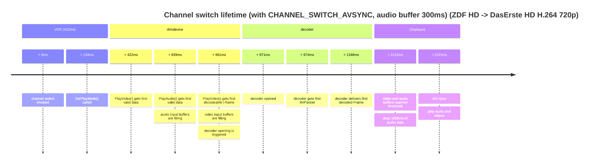

### Fast channel switch: video

Same as above, but immediately present the very first video frame as a stillpicture as soon as the decoder releases it without respect to buffer filllevels.
Start audio and video as soon as they are in sync and enough audio and video is buffered. This mode also drops all audio data which is older than the video PTS, which is waiting for the audio to come up.

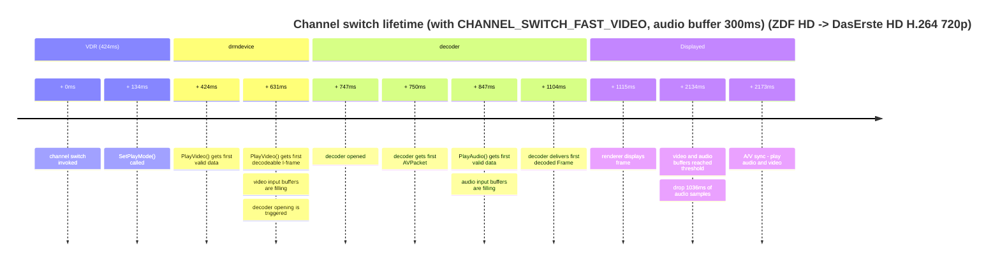

### Fast channel switch: video + audio

Same as the above mode with the difference, that (older) audio is also started immediately as soon as the audio buffer filllevel threshold is reached without respect to an a/v-sync. Audio data typically comes in with 160ms or 192ms packets,
so we may not hit the target buffer threshold value exactly. Therefore, we shrink the audio buffer as soon as its threshold is reached back to the threshold. This mode drops the superfluous audio data BEFORE the audio playback starts.
Otherwise we may have to wait for all audio data to be played out later, although all buffers reached the filllevel thresholds already and audio and video could start in sync.

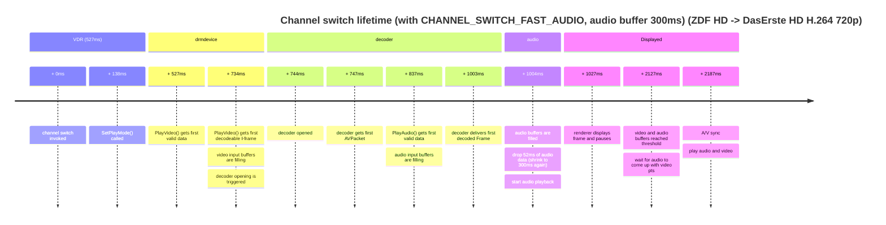


### Audio PTS calculation in normal playback and slow forward trickspeed

```mermaid
gantt
    title Audio PTS calculation
    dateFormat x
    axisFormat %L
    tickInterval 20millisecond
section Audio
    Buffered audio             :             0, 400
    m_pAudio->GetUsedRingbufferMs() :             100, 400
    m_pAudio->GetHardwareOutputDelayMs(): crit, 0, 100
    m_pAudio->GetHardwareOutputPtsMs(): milestone,  0,
    m_pAudio->GetOutputPtsMs(): milestone,  100,
    m_pAudio->GetInputPtsMs() : milestone, 400,
    m_pAudio->GetBufferFillLevelThresholdMs() :   crit, 100, 400
```


### Relationship between buffer filllevels and threshold (fast channel switch off)

```mermaid
---
displayMode: compact
config:
    gantt:
        numberSectionStyles: 2
        topAxis: true
---
gantt
    title A/V-Sync: Video waits for audio buffer to be filled
    dateFormat x
    axisFormat %L
    tickInterval 20millisecond
section Threshold
    GetBufferFillLevelThresholdMs()                        :             80, 530
    If audioBuffer reaches -> start playback               : vert,      530,
    GetFirstAudioPtsMsToPlay()                             : vert,       80,
    If audioBuffer reaches -> start playback               : milestone, 530,
    GetFirstAudioPtsMsToPlay()                             : milestone,  80,
section Audio
    audioBuffer             :              0, 480
    m_pAudio->GetOutputPtsMs(): milestone,   0,
    m_pAudio->GetInputPtsMs() : milestone, 480,
section AudioFilllevel
    to drop                    : crit,   0,  80
    syncedAudioBufferFillLevel :        80, 480
    to wait for                : crit, 480, 530
section Video
    videoBuffer                  :             80, 720
    m_pRender->GetOutputPtsMs()  : milestone,  80,
    m_pVideoStream->GetInputPtsMs(): milestone, 720,
section VideoFilllevel
    syncedVideoBufferFillLevel : 80, 720
```

```mermaid
---
displayMode: compact
config:
    gantt:
        numberSectionStyles: 2
        topAxis: true
---
gantt
    title A/V-Sync: Audio waits for video buffer to be filled
    dateFormat x
    axisFormat %L
    %% this next line doesn't recognise 'decade' or 'year', but will silently ignore
    tickInterval 20millisecond
section Threshold
    GetBufferFillLevelThresholdMs()                        :             80, 530
    If both buffers reach -> start playback                : vert,      530,
    GetFirstAudioPtsMsToPlay()                             : vert,       80,
    If both buffers reach -> start playback                : milestone, 530,
    GetFirstAudioPtsMsToPlay()                             : milestone,  80,
section Audio
    audioBuffer             :             80, 720
    m_pAudio->GetOutputPtsMs(): milestone,  80,
    m_pAudio->GetInputPtsMs() : milestone, 720,
section AudioFilllevel
    syncedAudioBufferFillLevel : 80, 720
section Video
    videoBuffer                  :              0, 480
    m_pRender->GetOutputPtsMs()  : milestone,   0,
    m_pVideoStream->GetInputPtsMs(): milestone, 480,
section VideoFilllevel
    to drop                    : crit,   0,  80
    syncedVideoBufferFillLevel :        80, 480
    to wait for                : crit, 480, 530
```

```mermaid
---
displayMode: compact
config:
    themeCSS: " #trans { fill: Transparent; stroke: Transparent; }"
    gantt:
        numberSectionStyles: 2
        topAxis: true
---
gantt
    title A/V-Sync: Wait for audio and video buffer to be filled
    dateFormat x
    axisFormat %L
    %% this next line doesn't recognise 'decade' or 'year', but will silently ignore
    tickInterval 20millisecond
section Threshold
    GetBufferFillLevelThresholdMs()                        :             80, 530
    after sync                                             : trans,      530, 720
    If videoBuffer reaches -> start playback               : vert,      530,
    GetFirstAudioPtsMsToPlay()                             : vert,       80,
    If videoBuffer reaches -> start playback               : milestone, 530,
    GetFirstAudioPtsMsToPlay()                             : milestone,  80,
section Audio
    audioBuffer             :             80, 400
    m_pAudio->GetOutputPtsMs(): milestone,  80,
    m_pAudio->GetInputPtsMs() : milestone, 400,
section AudioFilllevel
    syncedAudioBufferFillLevel :        80, 400
    to wait for                : crit, 400, 530
section Video
    videoBuffer                  :              0, 480
    m_pRender->GetOutputPtsMs()  : milestone,   0,
    m_pVideoStream->GetInputPtsMs(): milestone, 480,
section VideoFilllevel
    to drop                    : crit,   0,  80
    syncedVideoBufferFillLevel :        80, 480
    to wait for                : crit, 480, 530
```

### Example: Buffering a H.264 Live Stream

This is a real-life example, switching to the TV station "DMAX" (576i/H.264).

The first video packets (20.890-21.510s) are dropped, because they contain no codec information/I-frame.
So, the first frame the decoder outputs is 21.510s, which is also the first frame being displayed.

All audio samples are dropped (21.510-20.302=1.208s), which have PTS values before the initially displayed video frame to let audio and video start in sync.

At the point the buffer threshold is reached (450ms), the audio buffer has a size of 21.886-21.510=0.376s and the video buffer of 22.490-21.510=0.980s.

The audio buffer size is apparently below the threshold in this example.
Nevertheless, the buffer threshold is reached, because the PTS values represent the start of a frame, and the threshold calculation takes the end of the last audio frame into account.

The PTS timestamps in the following timeline are truncated to seconds for simplicity, but represent real values.

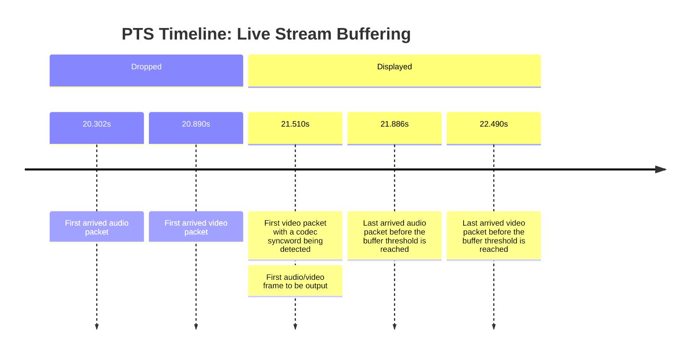

The time between the first received PES packet of this stream and the first pageflip are 1.8s in this example.

That the first PTS to be output is determined by the video stream seems to be the common case.
If the first audio packet arrives after the first decoded video frame, the initial PTS to be output would be determined by the audio stream.

Side note: For additional responsiveness/optimization, the first video packets (until the first sync word was received), were tried to put through the decoder (opened with the correct codec ID), but the decoder responded with invalid data.
Only tried with H.264.

## A/V Sync During Playback

After the playback start, the display thread keeps the video in sync with the audio.
The audio is the master clock: it is never stretched or skipped for the A/V sync, only the video frames are repeated or dropped.

The display thread runs `cVideoRender::DisplayFrame()` in a loop (every 1ms, or after 100µs after a page flip or a dropped frame).
A new frame is taken from the render queue only, if the current frame was displayed long enough (`m_framePresentationCounter`) and, in an interlaced display mode, only with every second call (`m_framesPerFlipCycle`).

For each new frame, `FrameDropNecessary()` compares the video PTS with the PTS of the audio, which is heard right now:

```text
audioBehindVideoByMs = videoPts - audioHardwareOutputPts - AudioDelay
```

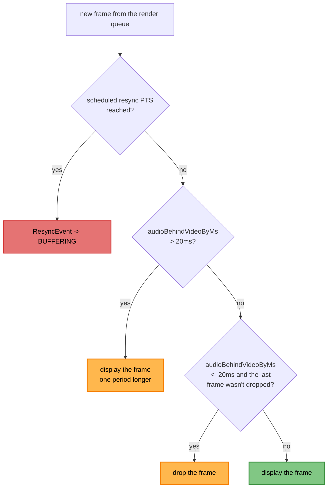

- A frame is dropped at most every second frame, otherwise the render queue would be drained at once.
- No frame is repeated or dropped, while the audio is paused or a resync is scheduled.
- The repeated and dropped frames are counted in the setup menu statistics ("Frames duped/dropped").

The clock drift between the broadcaster and the playback device is compensated in the audio (see below), so the video corrections are rare in a stable live stream.

### Resync

A jump of the PTS values (e.g. a new recording in the stream or a broken stream) can't be corrected by repeating or dropping single frames.

- **Audio:** If the input PTS jumps more than 5s (`AV_SYNC_BORDER_MS`), `cAudioStream::Enqueue()` schedules a resync at the new PTS (`ScheduleResyncAtPtsMsEvent`).
  When the video reaches this PTS, `FrameDropNecessary()` fires a `ResyncEvent` and the state machine buffers again (PLAY -> BUFFERING).
  A scheduled PTS, which is more than 5s away from the video PTS, is ignored (false positive).
- **Video:** If the PTS of a packet jumps more than 5s, `cVideoStream::SendPacket()` drains the decoder, so the frames before the jump are output first.

### Buffer Underrun

- **Video:** If the packet queue, the filter and the render queue are empty during playback, the display thread fires `BufferUnderrunEvent{VIDEO}`.
  This is skipped in trick speed, during a still picture, for video only playback and while the device is drained.
- **Audio:** If ALSA reports an underrun (`EPIPE`), the audio thread fires `BufferUnderrunEvent{AUDIO}` (not while the audio is paused or the device is drained).

Both lead to PLAY -> BUFFERING: the playback starts again in sync, when the buffers reached the threshold.

## Trick Speed and Still Picture

### Trick Speed

VDR mutes the audio before it changes to trick speed (see "Playmode Graph").
In fast forward/backward and slow backward, VDR sends only the I-frames, in slow forward it sends all frames.
VDR's speed value is a frame displaying count, which depends on the codec and the direction.
`cOutputDevice::TrickSpeed()` normalizes it to a factor (2.0 means twice as fast as normal, 0.5 half as fast):

| VDR speed | fast forward/backward | slow forward | slow backward |
|-----------|-----------------------|--------------|---------------|
| slowest   | 5                     | 1/6          | 1/3           |
| medium    | 10                    | 1/4          | 1/2           |
| fastest   | 15                    | 1/2          | 1             |

The display thread shows each frame for a number of display refreshes, which depends on the PTS distance to the previous frame (the I-frame distance), the refresh rate and the factor (`cVideoRender::GetFramePresentationCount()`):

```text
presentationCount = round(interFrameGap / refreshPeriod / factor), at least 1
```

Changes when entering TRICK_SPEED:

- The deinterlacer is deactivated, the filter thread only converts software decoded frames to NV12 (see "Frame Routing").
- Every DRM buffer is used only once and destroyed after its presentation (`cBufferStrategyUseOnce`).
- No A/V sync, no buffering threshold and no `BufferUnderrunEvent{VIDEO}`: the frames are shown as fast as demanded.
  A `TrickSpeedEvent` in BUFFERING changes to TRICK_SPEED immediately.
- The audio, which is older than the displayed frame, is dropped by the display thread.

In backward trick speed, the decoder would hold back the I-frames (it waits for the following frames to reorder them).
Therefore, the decoder is drained after each packet (`cVideoStream::CheckForcingFrameDecode()`), with interlaced H.264 after two packets.
After the drain, the decoder is flushed (or reopened with `QUIRK_CODEC_FLUSH_WORKAROUND`).

### Audio Only Trick Speed

There is no video, which advances the STC (`GetSTC()`) for VDR's progress display.
So the audio PTS is advanced instead:

- Fast forward/backward and slow backward: `PlayAudio()` doesn't decode the packets.
  It sets the STC to the PTS of each packet and sleeps for the PTS distance to the previous packet divided by the factor (`cAudioStream::AdvanceTrickSpeedPts()`).
- Slow forward: the audio thread drops 20ms of audio and sleeps for 20ms divided by the factor in each cycle.

### Still Picture

VDR calls `StillPicture()` with the data of one frame (e.g. when a mark is moved in the editing mode).
`cOutputDevice::HandleStillPicture()`:

- deactivates the deinterlacer (it would need the following frames),
- reassembles the PES packets and pushes the frame to the decoder,
- drains the decoder (`cVideoStream::Drain()`), so it outputs the frame at once,
- resets the input PTS of the video, so the still picture doesn't count as received video for the buffering,
- sets the renderer into still picture mode: no A/V sync and no `BufferUnderrunEvent{VIDEO}`.

## Broadcaster/Playback Device Clock Drift & Recovery

This plugin implements an active clock recovery mechanism to solve synchronization issues inherent in live streaming environments (e.g., DVB-S).
By using a PID controller to monitor buffer levels, the system compensates for hardware clock skew between the broadcast encoder and the playback device, preventing buffer underruns and overruns.

### The Challenge: Hardware Clock Drift

In any live stream, the sender's clock (broadcast encoder) and the receiver's clock (playback device) are never perfectly synchronized.
This discrepancy leads to two inevitable failure states:

- **Receiver is faster:** The device consumes audio samples faster than they are received. The buffer gradually drains, leading to an underrun.
- **Receiver is slower:** The device consumes samples too slowly. The buffer fills until it overflows.

Without active compensation, this drift is constant.
Calculations show that with a positive clock skew of 10ppm, a buffer of 330ms will underrun in approximately 9 hours.

This doesn't seem to be an issue when using audio passthrough.
Probably because the audio receiving device takes care of compensation.

### The Solution: PID-Controlled Resampling

To counteract drift, the plugin utilizes a **PID (Proportional-Integral-Derivative)** controller.
This controller continuously calculates the error between the current buffer fill level and the target level, dynamically adjusting the audio playback speed via resampling.

#### Mechanism

The adjustment involves imperceptibly adding or removing single audio samples.
For a typical 10ppm positive skew at 48kHz, roughly one sample is removed every 2 seconds.
While this prevents buffer underruns, it causes a drift in A/V sync, eventually necessitating a video frame drop/dupe to realign.

#### Control Loop Terms

- **Proportional (P):** Handles immediate corrections based on the current distance from the target buffer level.
- **Integral (I):** Handles long-term drift. It accumulates error over time to "learn" the steady-state clock skew (ppm difference).
- **Derivative (D):** Not currently used, but available for dampening if required.

### System Verification

The effectiveness of the PID controller was verified using **PlotJuggler**.

#### 1. Uncorrected State (Baseline)

Prior to implementation, the buffer exhibited a linear downward trend.
Eventually a buffer underrun occurred after 32,000s (~9h) and buffering started again leading to a short playback pause.

- **X-axis:** Time in seconds.
- **Upper Graph Y-axis:** Buffer fill level in ms.
- **Lower Graph Y-axis:** Compensation in ppm.


#### 2. Corrected State (PID Active)

With the PID controller active, the buffer locks onto the target level.

- **Stabilization Phase (0s - 1500s):** An initial dip occurs while the **Integral term (Orange Line)** accumulates data. Starting from 0, the controller takes time to learn the specific drift of the hardware.
- **Steady State (>1500s):** Once the Integral term stabilizes (in this example, at ~10ppm), the buffer level (Blue Line) recovers and tracks the target (Red Line) indefinitely, oscillating only slightly due to packet jitter.


Please note that the first graph's Y-axis range is more than 300ms and the range of the second is only 3ms.
This causes the second graph to look more jitterish, because it is more zoomed-in.

### Tuning & Visualization with PlotJuggler

The PID controller includes built-in telemetry to visualize internal state (P, I, D terms, input, and output) in real-time.
This is essential for tuning the PID parameters.

**To enable the tuning aid:**

1. **Enable Telemetry:** In `pidcontroller.h`, uncomment the macro `PID_CONTROLLER_TUNING_AID_ADDRESS`.
2. **Configure Target IP:** Set the value of the macro to the IP address of the machine running PlotJuggler. `cPidController::SendTuningAidData()` sends the data via UDP to this address.
3. **Setup PlotJuggler:**
    - Install [PlotJuggler](https://github.com/facontidavide/PlotJuggler).
    - Load the provided layout configuration file (located in the repo at `DEVELOPER/PidControllerPlotJugglerConfig.xml`). This will automatically configure the data series, graphs, and legends to match the screenshots above.
    - Start the UDP Server in PlotJuggler to begin receiving live data from the plugin.

## Misc

- The audio is initialized lazily (only when playback starts), because there is no sound device, yet, when HDMI is used as sound output, if the TV is off.
